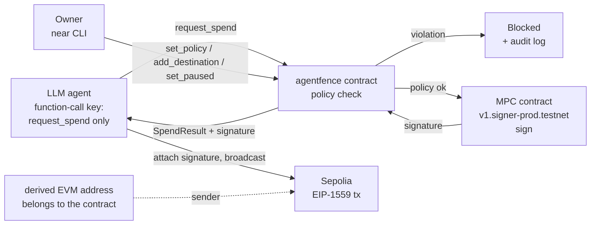

# AgentFence

**The agent can ask. The contract decides.**

A policy-enforced treasury for AI agents on NEAR. The agent holds only a
function-call key that can call one method. A smart contract checks every
spend request against on-chain rules, logs every decision, and only then asks
NEAR Chain Signatures to sign a real Sepolia transaction that the contract
builds itself.

Built for the NEAR Hackathon, track **AI Security & Defense**.

- Real Sepolia transaction produced end to end:
  [`0x388bc609…08126`](https://sepolia.etherscan.io/tx/0x388bc60903b143229dfdd9b3000c10b0a051d3a61668e340aaa7d45799608126)
  (status success, block 12103743)
- Network: NEAR **testnet** + Ethereum **Sepolia** only

---

## Why this exists

Give an AI agent a full-access key and one prompt injection can drain it.
Require a human for every payment and the agent is no longer autonomous.

AgentFence moves the decision out of the agent and into a contract:

- the agent can only **request** a spend,
- the contract decides whether the request is legal,
- the agent never holds a signing key and cannot change `to`, `value` or
  `chain_id` of the transaction that gets signed.

## How it works



1. The agent calls `request_spend(destination, amount, nonce, fees, gas_limit)`.
2. The contract evaluates the rules below, **first failure wins**.
3. A blocked request returns `Blocked` (it never panics, so the audit entry is
   kept) and is written to the on-chain audit log.
4. An allowed request reserves the daily budget, builds the EIP-1559
   transaction **inside the contract**, hashes it, and calls
   `sign` on the NEAR MPC contract with path `evm-sepolia-<agent_account>`.
5. The callback returns the signature to the agent, or refunds the reserved
   budget if signing failed.
6. The agent attaches the signature, verifies the recovered signer equals the
   contract-derived address, and broadcasts.

### Rule order and reason strings

| # | Rule | Reason on failure |
|---|------|-------------------|
| 1 | agent has a policy | `no policy for agent` |
| 2 | agent not paused | `agent is paused` |
| 3 | amount > 0 | `amount must be greater than zero` |
| 4 | destination allowlisted | `destination not allowlisted` |
| 5 | destination format `evm:0x` + 40 hex | `invalid destination format` |
| 6 | amount <= per-tx limit | `exceeds per_tx_limit` |
| 7 | spent today + amount <= daily cap | `exceeds daily_cap` |
| 8 | max_fee_per_gas * gas_limit <= 0.005 ETH | `fee exceeds max_fee_cap` |

If the MPC call fails, the reservation is refunded (same day only) and a
`sign failed, spend refunded` entry is appended.

The daily window is `block_timestamp / 86_400_000_000_000` (UTC days).

## Threat model

| Attacker / failure | What happens |
|--------------------|--------------|
| Prompt-injected agent asks for a new destination | Blocked: `destination not allowlisted` |
| Injected agent asks for a huge amount to an allowed address | Blocked: `exceeds per_tx_limit` |
| Agent tries to change its own policy | Refused by NEAR: method not allowed by the access key |
| Agent calls the MPC signer directly | Refused by NEAR: receiver does not match the access key |
| Agent attaches a deposit | Refused by NEAR: deposit not allowed with a function-call key |
| Agent bypasses the contract and calls MPC with its own account | The derived address depends on the *calling* account, so it would sign for a different address than the one the contract controls |
| Agent tampers with `to` / `value` / `chain_id` | Impossible: built inside the contract from the checked destination and amount. The agent supplies only nonce, fees and gas, and fees are capped |
| Owner pauses the agent | Every request is Blocked: `agent is paused` |

The refused calls above were run for real against the deployed contract. The
exact error text is in [`scripts/testnet-demo.md`](scripts/testnet-demo.md)
under "Bypass proof: scoped key" and in the dashboard
[Docs](dashboard/docs.html#security-proof) page under "Security proof".

## Evidence

- **Contract hash equals an independent implementation.** The contract's
  `preview_payload` hash and a viem-built signing hash for the same inputs are
  identical (`scripts/verify-hash/`).
- **Signer recovery.** The signed transaction's recovered signer equals the
  contract-derived address `0x44c8f698d9C2711925Af1Df0b9BB3d4b62E8ea57`.
- **Derivation checked two ways.** The library-derived address matches the one
  computed from the MPC contract's `derived_public_key` view.
- **Real broadcast.** See the Etherscan link at the top. Transcript in
  [`docs/real-broadcast.txt`](docs/real-broadcast.txt).
- **Unit tests.** Contract (20), SDK (18), CLI (10), MCP (5).

### Demo results (simulated compromised model)

| Scenario | Agent tried | Decision | Reason |
|----------|-------------|----------|--------|
| A legitimate invoice | pay 0.001 ETH to allowlisted address | Allowed (signature issued, broadcast skipped) | |
| B injected invoice | pay 0.05 ETH to a new address | Blocked | destination not allowlisted |
| C injected, huge amount | pay 5 ETH to the allowlisted address | Blocked | exceeds per_tx_limit |
| D legitimate invoice while paused | pay 0.001 ETH | Blocked | agent is paused |

Scenarios B to D use `--force-tool-call`, which **simulates** a compromised
model by calling the tool directly. Full log: `docs/demo-output.txt`.

## Live testnet deployment

| Thing | Value |
|-------|-------|
| Contract | `agentfence-contract-evm-0b497ae1.testnet` |
| Owner | `agentfence-owner-9a9635f2.testnet` |
| Agent | `agentfence-agent-9a9635f2.testnet` |
| MPC contract | `v1.signer-prod.testnet` |
| Derivation path | `evm-sepolia-agentfence-agent-9a9635f2.testnet` |
| Derived Sepolia address | [`0x44c8f698d9C2711925Af1Df0b9BB3d4b62E8ea57`](https://sepolia.etherscan.io/address/0x44c8f698d9C2711925Af1Df0b9BB3d4b62E8ea57) |
| Policy | per-tx 0.01 ETH, daily cap 0.05 ETH |

The derived address depends on the contract account. Redeploying to a new
account changes it.

## Repository layout

```
contract/    Rust, near-sdk 5. Policy, audit log, MPC call + callback
sdk/         TypeScript SDK (agentfence-sdk)
agent/       LLM payment agent + prompt-injection demo
mcp/         MCP server (stdio) exposing the agent tools
cli/         `agentfence` command line tool
dashboard/   Static HTML/JS: Try it, Live log, Docs
scripts/     Testnet runbook, EVM derive/send scripts, hash verification
docs/        Architecture, demo output, real broadcast transcript
```

## Getting started

Prerequisites: Node 20+, Rust with the `wasm32-unknown-unknown` target, the
[`near` CLI](https://github.com/near/near-cli-rs). On Windows you may also
need NASM on PATH for some crypto crates; use `CARGO_BUILD_JOBS=2` on small
machines.

```bash
# contract
cd contract
cargo test
cargo check --target wasm32-unknown-unknown
cargo build --target wasm32-unknown-unknown --release

# sdk (build it first, other packages depend on it)
cd ../sdk && npm install && npm run build && npm test

# cli
cd ../cli && npm install && npm run build && npm test
npm link                       # puts `agentfence` on your PATH

# mcp
cd ../mcp && npm install && npm test

# agent
cd ../agent && npm install
cp .env.example .env           # then fill in the values
```

`agent/.env` holds account names and a **path** to the agent's function-call
key file (kept outside the repo). Never put a private key in the repo.

The end-to-end CLI walkthrough (deploy, policy, audit log, MPC sanity check,
scoped key, real send) is in [`scripts/testnet-demo.md`](scripts/testnet-demo.md).

### Run the dashboard

```bash
npx serve dashboard
```

The "Try it" page runs a **simulation** against the live on-chain policy and
sends no transaction.

## Using it from your agent

### SDK

```ts
import { AgentFence } from 'agentfence-sdk';

const fence = new AgentFence({
  network: 'testnet',
  contractAccount: 'agentfence-contract-evm-0b497ae1.testnet',
  agentAccount: 'agentfence-agent-9a9635f2.testnet',
  agentKeyFile: process.env.AGENT_FCK_KEY_FILE!,
});

const { address } = await fence.deriveAddress();
const result = await fence.pay({
  to: '0x1111111111111111111111111111111111111111',
  amountWei: 1_000_000_000_000_000n,
  broadcast: false,
});
console.log(result.decision, result.reason ?? '');
```

Install from this repo (`npm install ./sdk`); it is not published to npm.

`pay()` returns a `Blocked` result instead of throwing. It throws
`AgentFenceError` (with a `code`) only for real failures: `CONFIG`,
`ADDRESS_FORMAT`, `FEE_CAP`, `PAYLOAD_MISMATCH`, `SIGNATURE_MISSING`,
`SIGNER_MISMATCH`, `NETWORK`. On `Allowed` it verifies the payload hash
against `preview_payload`, applies EIP-2 low-s normalization, and requires the
recovered signer to equal the derived address before it will broadcast.

| Method | Returns |
|--------|---------|
| `deriveAddress()` | `{ address, publicKey }` |
| `getPolicy()` | `Policy \| null` |
| `getSpentToday()` | `bigint` (wei) |
| `getAuditLog({ from, limit })` | `AuditEntry[]` |
| `preview(args)` | `{ payloadHash } \| null` |
| `pay({ to, amountWei, broadcast? })` | `PayResult` |

### MCP server

A standard stdio MCP server. Example client entry:

```json
{
  "mcpServers": {
    "agentfence": {
      "command": "npx",
      "args": ["tsx", "mcp/src/index.ts"],
      "env": {
        "CONTRACT_ACCOUNT": "agentfence-contract-evm-0b497ae1.testnet",
        "AGENT_ACCOUNT": "agentfence-agent-9a9635f2.testnet",
        "AGENT_FCK_KEY_FILE": "/absolute/path/to/function-call-key.txt"
      }
    }
  }
}
```

Tools: `pay`, `get_policy`, `get_spent_today`, `get_audit_log`, `get_address`.
`pay` never broadcasts unless the server starts with `--allow-broadcast`.
A `Blocked` decision is a normal tool result, not an MCP error.

### CLI

```bash
agentfence status
agentfence audit --limit 10
agentfence apply agentfence.policy.json --dry-run
agentfence apply agentfence.policy.json --yes
agentfence pause --yes
agentfence resume --yes
agentfence pay 0x1111111111111111111111111111111111111111 1000000000000000
```

Owner-signed calls go through the `near` CLI with the owner key in your
keychain. This tool never reads or stores owner keys. Policy file format:

```json
{
  "contract": "agentfence-contract-evm-0b497ae1.testnet",
  "owner": "agentfence-owner-9a9635f2.testnet",
  "agent": "agentfence-agent-9a9635f2.testnet",
  "perTxLimitWei": "10000000000000000",
  "dailyCapWei": "50000000000000000",
  "allowlist": ["0x1111111111111111111111111111111111111111"],
  "paused": false
}
```

See `agentfence.policy.example.json`.

### Give the agent only a function-call key

The agent's NEAR key must be a function-call key limited to
`request_spend` on the contract, with no deposit:

```bash
near account add-key <AGENT_ACCOUNT> grant-function-call-access \
  --receiver-account-id <CONTRACT_ACCOUNT> \
  --method-names request_spend \
  --allowance '1 NEAR' \
  use-manually-provided-public-key <PUBLIC_KEY> \
  network-config testnet
```

Check the exact flags with `near account add-key --help` for your installed
version. The verified command is in the "Bypass proof: scoped key" section of
`scripts/testnet-demo.md`.

## Contract reference

All amounts are `U128` strings (wei). Destinations are `evm:0x` + 40 hex.

| Method | Caller | Purpose |
|--------|--------|---------|
| `new(owner, mpc_account)` | init | One-time initialization |
| `set_policy(agent_id, per_tx_limit, daily_cap)` | owner | Requires `0 < per_tx <= daily`; keeps `paused` on update |
| `add_destination(agent_id, destination)` | owner | Allowlist entry |
| `remove_destination(agent_id, destination)` | owner | |
| `set_paused(agent_id, paused)` | owner | Panics if the agent has no policy |
| `request_spend(destination, amount, nonce, max_fee_per_gas, max_priority_fee_per_gas, gas_limit)` | agent | Agent is `predecessor_account_id`; non-payable |
| `on_sign(...)` | private | MPC callback; refunds on failure |
| `get_policy(agent_id)` | view | |
| `is_destination_allowed(agent_id, destination)` | view | |
| `get_spent_today(agent_id)` | view | |
| `get_audit_log(from_index, limit)` | view | |
| `preview_payload(...)` | view | Signing hash with no state change |
| `get_owner()`, `get_mpc_account()` | view | |

Constants: chain id `11155111` (Sepolia), signing deposit `0.05 NEAR`
(refunded), `sign` gas `300 TGas`, callback gas `50 TGas`, fee cap
`0.005 ETH`.

## Honest limitations

- Spend is reserved when the signature is requested, not when the transaction
  is mined. A failed or skipped broadcast does not refund it. Only an MPC
  failure refunds.
- Testnet and Sepolia ETH transfers only. No tokens, no mainnet.
- No TEE. The MPC network is the trust root for signing.
- An allowlisted destination is trusted: the fence constrains the agent, not
  the supplier.
- The owner is a single key (no multisig).
- The audit log stores decisions, not the signature or payload hash. The hash
  is returned in the result, not stored on-chain.
- The injection demo uses `--force-tool-call` to simulate a compromised model
  unless run with a real LLM. Modern models often refuse simple injections,
  which is why the contract, not the model, is the safety layer.
- The derived EVM address changes if the contract is redeployed to a new
  account.
- The dashboard "Try it" page is a simulation, not an on-chain event.

## Roadmap

TEE attestation of the signing path, multisig owner, ERC-20 and more chains,
NEAR Intents for settlement, time-window and velocity policies, reputation
scoring.

## License

MIT. See [LICENSE](LICENSE).
